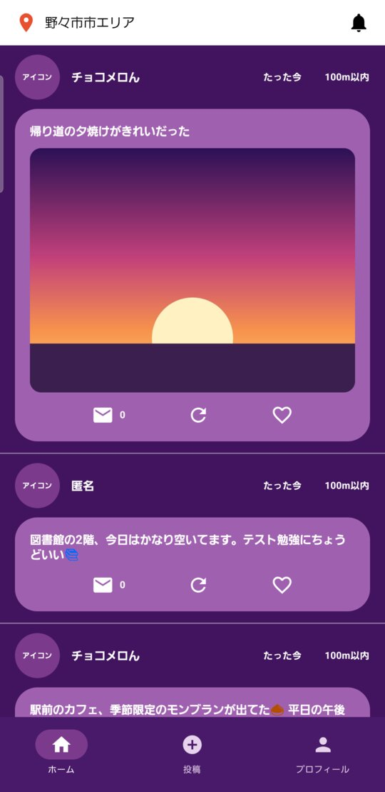
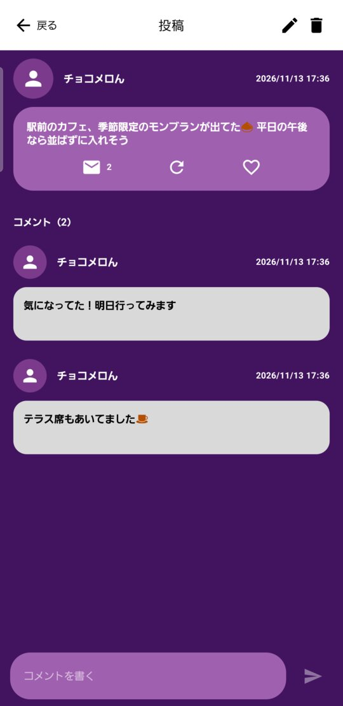
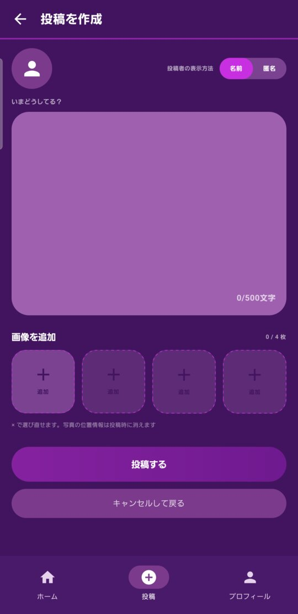
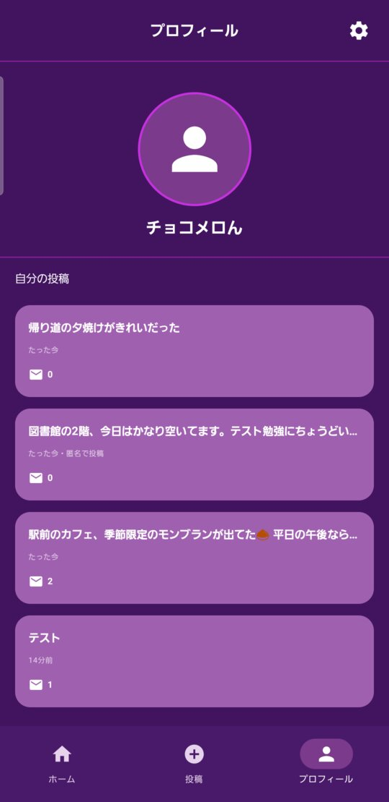

# Plesion

[](https://github.com/lemonade-2061/Plesion/actions/workflows/android-ci.yml)

近くにいる人（半径1km以内）の投稿を見たり、自分の投稿を共有したりできる、位置情報ベースの Android 向け SNS アプリです。

## スクリーンショット

| ホーム（近くの投稿） | 投稿詳細・コメント | 投稿作成 | プロフィール |
|---|---|---|---|
|  |  |  |  |

## 主な機能

- **Google ログイン**（Firebase Authentication）。設定画面からログアウトできる
- **近くの投稿**: 現在地から半径 1km 以内・直近 24 時間の投稿をホームに表示（引っ張って更新）。上部に現在地の市区町村名を出す。距離は「100m以内」のようにぼかして出す
- **投稿**: 本文（500 文字まで）と画像（4 枚まで、Photo Picker）。**匿名**でも投稿できる
- **投稿詳細**: コメントの一覧と投稿。自分の投稿は**編集・削除**できる
- **プロフィール**: 自分の投稿の一覧（匿名で出したものも含む）

### プライバシーへの配慮

- 投稿の位置は**丸めてから保存**し、正確な位置はどこにも残さない
- 画像は圧縮時に**位置情報などの Exif を消して**からアップロードする
- 匿名投稿には投稿者の uid を入れず、本人しか読めない場所に分けて保存する
- 他人の uid で投稿を集めるクエリは、セキュリティルールとインデックスの設計で拒否する

仕様の詳細は [docs/DATA_CONTRACT.md](docs/DATA_CONTRACT.md)。

## 採用技術

| 分類 | 技術 |
|---|---|
| 言語 | Kotlin 2.3.21 |
| UI | Jetpack Compose（BOM 2025.12.01）/ Material 3 |
| 設計 | MVVM + Repository |
| 画面遷移 | Navigation Compose 2.9.6 |
| 非同期 | Kotlin Coroutines / Flow |
| DI | 手動 DI（`di/AppContainer.kt`） |
| ビルド | Gradle 8.13（Kotlin DSL）/ Android Gradle Plugin 8.13.2 |
| SDK | minSdk 26 / compileSdk・targetSdk 36 |
| バックエンド | Firebase Authentication（Google、Credential Manager）/ Cloud Firestore / Cloud Storage（Firebase BoM 35.0.2） |
| 1km 検索 | geohash の範囲クエリ + 距離での絞り込み |
| 位置情報 | Fused Location Provider |
| 画像表示 | Coil 2.7.0 |
| テスト | JUnit（ViewModel・Repository）/ Compose UI テスト / Firebase Emulator（セキュリティルール） |

バージョンは `gradle/libs.versions.toml` で一元管理しています。

## 開発環境のセットアップ

1. **Android Studio** をインストール（2025.x 以降推奨）。
2. SDK Manager で **Android SDK Platform 36** をインストール。
3. リポジトリを取得:
   ```bash
   git clone https://github.com/lemonade-2061/Plesion.git
   cd Plesion
   ```
4. Android Studio で `Plesion` フォルダを **Open** → Gradle Sync が自動で走ります。
5. Firebase に接続するには `google-services.json` を `app/` に置く（[docs/FIREBASE_SETUP.md](docs/FIREBASE_SETUP.md)）。PC ごとに SHA-1 の登録が必要です。
   - **置かなくてもビルド・起動できます。** そのときは `data/local/` の Fake 実装（仮データ）で動きます（CI もこの状態）。
6. Gradle の JDK は Android Studio 同梱の JDK（JBR 21）を使ってください（Settings → Build Tools → Gradle → Gradle JDK）。
   - ⚠️ JDK 25 など新しすぎる JDK では Gradle 8.13 が動きません。

## ビルド・起動手順

- Android Studio: 上部の ▶ (Run 'app') を押す。エミュレータ（例: Pixel, API 34 以上）か実機で起動します。
- コマンドライン（macOS 例）:
  ```bash
  export JAVA_HOME="/Applications/Android Studio.app/Contents/jbr/Contents/Home"
  ./gradlew assembleDebug        # APK を作る
  ./gradlew installDebug         # 接続中の端末にインストール
  ./gradlew testDebugUnitTest    # 単体テスト
  ./gradlew lintDebug            # 静的チェック
  ./gradlew connectedDebugAndroidTest  # UI テスト（エミュレータか実機が必要）
  ```
- セキュリティルールのテスト: [firestore-tests/README.md](firestore-tests/README.md)（Node.js と Firebase CLI が必要）

起動すると Google ログイン → ホーム / 投稿 / プロフィール（→ 設定）を行き来できます。位置情報の許可が必要です。

## ディレクトリ構成

```text
app/src/main/java/jp/plesion/app/
├── MainActivity.kt          … 起動点
├── PlesionApplication.kt    … AppContainer を作る（Firebase 初期化もここ）
├── PlesionApp.kt            … テーマ + ナビゲーションのルート
├── navigation/              … ルート定義と NavHost（共通ファイル）
├── feature/                 … 画面ごとのフォルダ（Screen + ViewModel）
│   ├── auth/                … ログイン
│   ├── feed/                … ホーム・タイムライン（detail/ … 投稿詳細・コメント）
│   ├── post/                … 投稿作成
│   ├── profile/             … プロフィール
│   └── settings/            … 設定
├── data/
│   ├── model/               … Post, User, Comment, GeoPoint
│   ├── repository/          … Repository インターフェース（共通ファイル）
│   ├── local/               … 仮データと Fake 実装（google-services.json がないとき用）
│   └── remote/              … Firebase 実装（Auth・Firestore・Storage）
├── core/
│   ├── ui/                  … テーマ・UiState・ローディング/エラー表示・位置情報の許可
│   ├── location/            … 現在地の取得・位置の丸め・距離計算
│   └── image/               … 画像の縮小・Exif の削除
└── di/AppContainer.kt       … 依存関係の組み立て（共通ファイル）

firestore.rules / storage.rules   … セキュリティルール
firestore.indexes.json            … Firestore のインデックス
firestore-tests/                  … ルールのテスト（Firebase Emulator）
```

詳しくは [docs/ARCHITECTURE.md](docs/ARCHITECTURE.md)。

## 担当領域

| メンバー | 領域 | 主なフォルダ |
|---|---|---|
| tanabe | Android UI（ホーム・タイムライン・投稿カード・投稿詳細・画面遷移） | `feature/feed/`, `navigation/`, `core/ui/theme/` |
| tajima | Android 機能（ログイン画面・投稿作成・画像添付・編集削除・プロフィール） | `feature/auth/`, `feature/post/`, `feature/profile/` |
| takuma | バックエンド（Firebase・Google 認証・Firestore・1km 検索・アクセス制御） | `data/remote/`, `core/location/`, Firebase コンソール |

**共通ファイル**（`navigation/`, `data/model/`, `data/repository/`, `di/`, `core/ui/` の共通部品, `gradle/libs.versions.toml`, `app/build.gradle.kts`）を変更するときは、**PR を出す前にチャットで関係者に一声かける**こと。詳細は [docs/FEATURE_OWNERSHIP.md](docs/FEATURE_OWNERSHIP.md)。

## ブランチ・PR 運用ルール

- `main` には直接 push しない。必ずブランチ → PR → レビュー1人以上 → マージ。
- ブランチ名: `feature/<内容>`, `fix/<内容>`, `chore/<内容>`（例: `feature/home-timeline`）。
- 1つの PR は小さく（目安 300 行以内）。1 PR = 1 つの目的。
- PR を出す前に `./gradlew assembleDebug testDebugUnitTest` が通ることを確認する。
- PR を作ると GitHub Actions（`.github/workflows/android-ci.yml`）が自動でビルド・テスト・Lint を実行する。**赤（失敗）のままマージしない。**
- 作業前に `git pull origin main` で最新化し、こまめに main を取り込む。
- `google-services.json`・API キー・署名鍵は**絶対にコミットしない**（`.gitignore` 済み）。

詳しくは [docs/DEVELOPMENT.md](docs/DEVELOPMENT.md)。

## 未実装・今後の課題

- プッシュ通知（FCM）。ホーム右上のベルは押しても何も起きない
- プロフィールの編集（名前・アイコンの変更）
- いいね・リポスト（期限までに仕様を決めきれないため見送り。ボタンも出していない）
- エリアの切り替え（ホーム上部には現在地の市区町村名だけを出す）
- ホームの投稿カードのアバターが「アイコン」の文字のまま

スケジュールは [docs/ROADMAP.md](docs/ROADMAP.md)。
